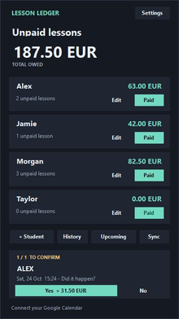
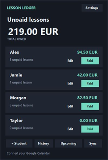
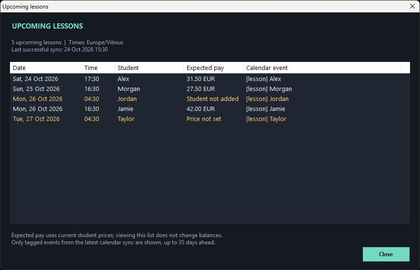
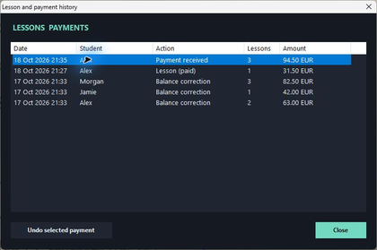

# Lesson Ledger

**A Windows desktop widget that helps me keep track of unpaid tutoring lessons.** It reads tagged lessons from Google Calendar, asks whether they happened, and adds confirmed lessons to each student's balance.

I built it to spend less time working out who owes what.

| A lesson waiting for confirmation | After confirming the lesson |
| :---: | :---: |
|  |  |

*The actual app in its offline preview mode. All student names, lessons, prices, and balances shown here are fictional. Confirming Alex's example lesson adds €31.50: his balance changes from €63.00 to €94.50.*

**[Try the demo or set it up](docs/USAGE.md)** · **[Source code](LessonLedger.cs)**

---

## Why I made it

I am a private tutor, and my lessons are already in Google Calendar. But lessons move, get cancelled, or end up shorter than planned. Different students can have different prices, and I still have to work out their unpaid totals afterwards.

I wanted a small widget that stayed on the desktop and handled the repetitive part. It should use the schedule I already have, ask me what actually happened, and keep the running totals somewhere easy to check.

## How I use it

1. **Mark a lesson in Calendar**, for example `[lesson] Alex`.
2. **Confirm it in the widget** when its scheduled start arrives. Yes adds one lesson at that student's current price; No records that it did not happen without adding a charge.
3. **Check the unpaid totals** for each student and the combined amount at the top.
4. **Press Paid after receiving the full balance.** The unpaid count and amount clear, while the records stay in History.

For shorter lessons and other small corrections, I use **Edit** to adjust the current balance. There is no dedicated partial-lesson button, but this is enough for how I use it.

The widget normally sits behind other application windows, ready when I show the desktop. It checks the calendar periodically and keeps unanswered questions available until I deal with them.

## A look at the lessons ahead

**Upcoming** sits beside + Student, History, and Sync. It opens a read-only list of downloaded future lessons, showing their date, time, student, expected pay, and original calendar title. Lessons are ordered by their actual start time and displayed in **Europe/Vilnius** time, including daylight-saving changes.

*Fictional examples: Alex's next lesson is estimated at €31.50, independently of his unpaid balance. Jordan is marked Student not added; Taylor is marked Price not set.*

Expected pay uses each student's current lesson price. Opening the list adds no charges and changes no balances. It respects the tracking start date, shows the last successful sync, and refreshes if an in-progress sync finishes while it is open. It uses the existing calendar cache, which is fetched up to 35 days ahead, so it is a snapshot of downloaded lessons rather than a separate live calendar view.

## History makes it easier to correct mistakes

History records lesson confirmations, skipped lessons, balance corrections, and payments. An eligible payment can be undone to restore the previous unpaid balance. If that student has newer changes, I use Edit instead.

*Fictional example: the €94.50 payment is selected. Undo restores Alex's three unpaid lessons and their balance when no newer changes prevent it.*

## Making it work for my routine

I built the initial app in **one sitting, around October 2026**, with AI writing the code. The idea and the workflow came from me. I tried the app, explained what I liked and what got in the way, and asked the chat to change it until it suited my routine.

The refinements were mostly practical: getting the actual desktop widget to draw properly, improving startup, showing every student without scrolling, removing an empty confirmation card, and stopping the student list from flashing during sync.

I have been using it regularly, and it works well for me. Being able to look back through the history and undo a payment is one of the parts I appreciate most.

## How it works

The interface is a small **C# Windows Forms** app. A **Node.js** helper reads a Google Calendar iCal feed and uses **ical.js** to handle calendar events and repeating lessons. The app matches tagged event titles to students, then waits for my confirmation before recording a charge.

Calendar access is read-only. Lesson and payment records are saved locally. The private calendar link is encrypted for the current Windows user. No AI service is needed to run the app.

## Current limits and things I might add

- **Local records:** there is a previous-save backup, but no automatic off-device or cloud backup. A better backup/export option is the next improvement I would like to make.
- **Manual corrections:** shorter lessons and partial amounts use Edit. A separate button might make this more convenient.
- **A rare placement glitch:** once, the widget appeared above another application's window. I have not fixed that yet.
- **Calendar timing:** changes can take time to arrive through Google's feed. The app refreshes about every five minutes, with a Sync button for a manual refresh.
- **A personal setup:** it is Windows-only, currently uses the Europe/Vilnius timezone, and matches students through event-title names.

## Try it

You need **Windows**, the **.NET Framework compiler** used by `build.ps1`, and **Node.js 24**. The source package includes the calendar parser and a fictional demo. A ready-made executable is not included.

The [setup guide](docs/USAGE.md) covers building the app, trying the demo without connecting a calendar, connecting your own Google Calendar, and backing up local records.

---

Created by **Vytenis Narmontas** from a problem in my own tutoring routine. AI wrote the application; I supplied the idea, requirements, and feedback from using it.

**License:** [MIT](LICENSE) for this project's code and documentation. The included **ical.js 2.2.1** retains its [MPL-2.0 license](vendor/package/LICENSE) and original source. See [third-party notices](THIRD_PARTY_NOTICES.md).
