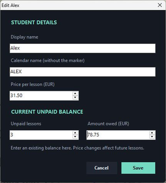

# Using Lesson Ledger

[Back to the project](../README.md)

## Build and run

This version is a Windows desktop app. It uses the .NET Framework compiler normally available at `%WINDIR%\Microsoft.NET\Framework64\v4.0.30319\csc.exe`; the build script reports if it is missing. A separate .NET SDK is not used by this build.

1. Install **Node.js 24** from the [official Node.js download page](https://nodejs.org/en/download), or obtain its official Windows portable distribution.
2. Download this repository and extract it to a writable folder.
3. Put `node.exe` in the repository's `vendor` folder. If Node is already on your PATH, the following command copies it there.
4. Build and launch from PowerShell in the repository folder:

```powershell
Copy-Item -LiteralPath (Get-Command node.exe -CommandType Application).Source -Destination .\vendor\node.exe
.\build.ps1
.\launch.ps1
```

If using the portable Node distribution, copy its `node.exe` into `vendor` manually and run the last two commands. Keep the rest of the repository alongside the built executable: the calendar helper and its parser are needed for sync.

The published source excludes Node's executable and generated app binaries. Locally, `vendor/node.exe` and the built `.exe` are ignored by Git. This update was tested with Node.js 24.22.1.

## Try the fictional demo first

You can explore the actual interface without connecting a calendar:

```powershell
.\vendor\node.exe .\demo\prepare-demo.mjs
Start-Process -FilePath .\LessonLedger.exe -ArgumentList '--preview --data "demo\data"' -WindowStyle Hidden
```

This opens a normal preview window with **Alex, Jamie, Morgan, and Taylor**, fictional balances, and a due lesson. Preview mode disables calendar sync and uses only the sample records in `demo/data`. The main app's `Data` folder is separate.

- Answer **Yes** for Alex: the balance changes from **€63.00 to €94.50**.
- Press **Paid** for Alex: the unpaid balance and count clear.
- Open **History**, select the payment, and use **Undo selected payment** to restore it.
- Use **Edit** to try a balance correction.
- Open **Upcoming** to see five fictional future events. The list uses current lesson prices, and unmatched Jordan remains visible as **Student not added**.

To recreate the sample records, close the preview and run the preparation command with `--reset`. This replaces the fictional demo ledger and cache only. The demo does not contain a calendar address.

For the missing-price example shown in the README, close the preview and run:

```powershell
.\vendor\node.exe .\demo\prepare-demo.mjs --reset --upcoming-examples
```

This keeps the same fictional balances and sets Taylor's future lesson price to zero, so Upcoming displays **Price not set**. Reopen the preview with the command above. Run the preparation command with `--reset` alone to return to the usual sample prices.

## Connect your own calendar

Launch normally, then:

1. Use **+ Student** to add each student. Set a display name, calendar name, and price per lesson. Enter any existing unpaid count and amount separately; they need not equal the current price multiplied by the count.
2. Open **Settings**. In Google Calendar's settings, choose your calendar, then **Integrate calendar → Secret address in iCal format**. Paste that address into the app. [Google's instructions](https://support.google.com/calendar/answer/37648) explain this read-only calendar feed and keeping its address private.
3. Set the **tracking start date** to suit your records. The current default is **2026-10-02**; it is not automatically today's date.
4. Tag events as `[lesson] Alex`, using the student's Calendar name after the marker. Matching ignores case. The marker can be changed in Settings.
5. Save, then use **Sync**. The app also attempts a refresh about every five minutes and checks for due questions about every 15 seconds.

The app reads events and does not edit your calendar. It tracks tagged timed events, including recurring lessons and moved occurrences. Untagged, cancelled, all-day, and `[ignore]` events are excluded. The `[ignore]` marker is the generic exclusion used by this publication copy.

An unanswered event becomes a question at its start time, not its end. **Yes** records one lesson at the current student price; **No** records a skipped lesson. Event duration does not automatically reduce the price. Cached questions can be answered offline; catching up on events not yet downloaded requires a successful sync.

If an earlier lesson is already included in an opening balance and also appears as a due question, answer No for that occurrence so it is not charged twice.

This version uses **Europe/Vilnius** for lesson display, tracking-date boundaries, and floating calendar times. The Windows timezone identifier is `FLE Standard Time`. Choosing another currency changes its label only; it does not convert amounts.

## Upcoming lessons

The **Upcoming** button shares the widget's existing action row with **+ Student**, **History**, and **Sync**. It opens a read-only list with **Date**, **Time**, **Student**, **Expected pay**, and **Calendar event** columns.

- Rows are sorted by the actual start instant, including timestamps with different timezone offsets. Displayed dates and times use Europe/Vilnius and follow its daylight-saving rules.
- Only downloaded events at or after both now and the configured tracking start are included. A future event remains visible even if it already has a recorded lesson answer.
- Student matching uses the saved calendar name, ignoring surrounding whitespace and case. The original event title is displayed separately.
- Expected pay is the matched student's current lesson price, not their existing balance, a historical charge, or a duration-based calculation. Unknown students show **Student not added**; non-positive or missing prices show **Price not set**. These rows are kept in the list without an invented amount.
- The header shows the last successful sync time and whether a sync is in progress. The view refreshes from the updated in-memory cache when a background sync finishes; an unchanged row set is retained without rebuilding it.

Opening the list does not start another download. Use **Sync** on the widget to fetch updates. The existing fetch window ends up to **35 days after the sync**, so events beyond that horizon are not available in this view. Without a successful sync, the list explains how to connect a calendar; an empty synced cache shows a separate no-upcoming-lessons message.

This view changes no balances, lesson decisions, payments, calendar events, storage schema, or startup settings. Actual charges still require the usual confirmation workflow.

## Corrections and payments

**Edit** changes the name, calendar match, future lesson price, unpaid count, and unpaid amount. Changing the price does not recalculate older lessons. The unpaid count is a whole number; the amount can be adjusted separately for a shorter lesson or another correction.

[](../media/edit-balance.png)

*Fictional example: reducing Alex's €94.50 balance to €78.75 to account for a half-price lesson, while keeping the normal lesson price at €31.50.*

**Paid** records receipt of the student's entire outstanding balance and clears their displayed unpaid totals. It does not transfer money. Use Edit for a partial amount rather than Paid.

History preserves entries and payments. **Undo selected payment** is available only when that student has no newer ledger entries or active payments. Other corrections use Edit; History is not a general undo button for every action.

## Desktop behaviour and startup

The normal widget sits near the top right of the selected monitor, behind other application windows. Use Windows' Show desktop action to reach it. It has no reminder sound or pop-up notification.

The right-click and system tray menus provide **Settings**, **Sync now**, **Reattach to desktop**, and **Quit**. Reattach can help if Windows disrupts the placement. There is a known occasional case where the widget appears above another app.

Automatic startup is optional in Settings. It creates a sign-in task for the current Windows user, pointing at this executable. Disable it before moving the app folder, then enable it again from the new location. Running the normal executable again opens Settings for the existing instance.

The widget grows with the student list. Very large lists and a wide range of monitor/DPI combinations have not been verified.

## Data and manual backup

Records stay in the app folder:

| File | Purpose |
| --- | --- |
| `Data/ledger.json` | Students, lesson decisions, corrections, and payments |
| `Data/ledger.json.bak` | The previous successful ledger save |
| `Data/calendar.json` | Downloaded, filtered calendar events |
| `Data/calendar-link.dat` | Calendar address encrypted for the current Windows user |

The ledger and cache are ordinary local JSON. Only the private calendar address is encrypted. Keep all of these files out of public repositories and screenshots.

For a manual backup, quit the app and copy the **Data folder** to another safe location. The previous-save file lives on the same computer and is not protection against losing that computer. Automatic remote backup is not implemented.

To restore records, close the app and restore a known-good `ledger.json` in the Data folder. If using the previous-save backup, preserve a copy of the current files first. On another Windows account or computer, reconnect the calendar in Settings; the encrypted address may not be readable there. Backup and migration recovery have not been tested end to end in this publication review.

## Checks included with the source

```powershell
.\vendor\node.exe --test calendar.test.mjs
Start-Process -FilePath .\LessonLedger.exe -ArgumentList '--self-test' -Wait -WindowStyle Hidden
Get-Content .\test-results.txt
```

The calendar suite checks filtering, recurrence, rescheduling, cancellations, daylight-saving changes, and feed-address restrictions. The ledger checks exercise confirmations, prices, payments, undo rules, saving, and encryption with test records. The upcoming checks cover filtering, chronological ordering across offsets, calendar-name matching, original titles, current prices, missing information, unchanged accounting state, empty caches, and the tracking date. They write only local test output and isolated `qa` records.

The Upcoming update passed **10 calendar tests, 15 ledger checks, and 8 upcoming-lesson checks**. Fictional-data preview and dialog checks covered the four-button layout, confirmation, missing students and prices, cache refresh while open, retained unchanged rows, and empty/no-sync messages. Additional checks covered the repeated daylight-saving hour and future events with existing answers. A fresh real calendar connection, a complete Windows reboot, and disaster recovery were not tested during this publication update.
